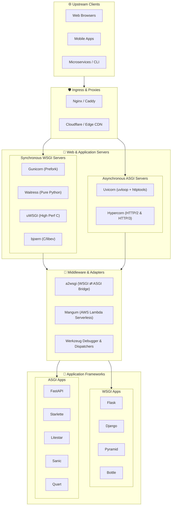

<div align="center">



# 🌐 Awesome WSGI Web Utilities

### Curated Directory of Python WSGI & ASGI Web Frameworks, Application Servers, Middleware & Tooling

<p align="center">
  <a href="https://github.com/ishandutta2007/Awesome-Awesome-Awesome"></a><a href="https://discord.gg/jc4xtF58Ve"></a>
  <a href="https://opensource.org/licenses/MIT"></a>
  <a href="https://www.python.org/"></a>
  <a href="https://peps.python.org/pep-3333/"></a>
  <a href="https://asgi.readthedocs.io/"></a>
  <a href="https://github.com/ishandutta2007/Awesome-WSGI-Web-Utilities/pulls"></a>
  <a href="https://github.com/ishandutta2007"></a>
</p>

<p align="center">
  <strong>A comprehensive, SEO-optimized guide to building, running, and scaling Python web applications.</strong><br>
  Covering classic synchronous WSGI (PEP 3333) engines, asynchronous ASGI 3.0 runtimes, battle-tested HTTP servers, modular middleware pipelines, and developer hosting platforms.
</p>

</div>

---

## 📑 Table of Contents

- [🔍 Overview: The Python Gateway Ecosystem](#-overview-the-python-gateway-ecosystem)
  - [WSGI vs. ASGI Architecture](#wsgi-vs-asgi-architecture)
- [📊 Sector Overview & Market Dynamics](#-sector-overview--market-dynamics)
- [☁️ SaaS & Hosted Platforms](#️-saas--hosted-platforms)
- [⭐ Open-Source Projects (Ranked by GitHub Stars)](#-open-source-projects-ranked-by-github-stars)
  - [Full Star-Ranked Directory](#full-star-ranked-directory)
  - [Categorized Architecture Breakdown](#categorized-architecture-breakdown)
- [🛠️ Composable Production Stack Recipes](#️-composable-production-stack-recipes)
- [🤝 How to Contribute](#-how-to-contribute)
- [📈 Star History](#-star-history)
- [💖 Support & Community](#-support--community)
- [⚖️ Disclaimer & Security Best Practices](#️-disclaimer--security-best-practices)

---

## 🔍 Overview: The Python Gateway Ecosystem

The **Web Server Gateway Interface (WSGI)**, standardized under [PEP 3333](https://peps.python.org/pep-3333/), is the universal interface contract connecting traditional Python web application code with upstream HTTP web servers. WSGI created standard interoperability across web frameworks (such as Flask, Django, and Pyramid) and production servers (such as Gunicorn, uWSGI, and Waitress).

With the rise of asynchronous programming in Python 3.5+ (`asyncio`), the **Asynchronous Server Gateway Interface (ASGI)** evolved as the modern spiritual successor to WSGI. ASGI introduces native asynchronous capabilities, bidirectional streaming, WebSockets, long polling, and HTTP/2 & HTTP/3 protocol support, powering high-throughput frameworks like FastAPI, Starlette, and Litestar.

```text
[ Client Browser / API Consumer ]
                │  HTTP / HTTPS / WebSockets
                ▼
  [ Reverse Proxy / Edge Ingress ] (Cloudflare, Nginx, Caddy, Traefik)
                │  Unix Domain Socket / TCP
                ▼
 [ Application Server (WSGI / ASGI) ] (Gunicorn, Uvicorn, Hypercorn, Waitress)
                │  PEP 3333 Environment / ASGI Scope Events
                ▼
      [ Middleware Pipeline ] (CORS, Sessions, Auth, Compression, Sentry)
                │  Callable Dispatch
                ▼
 [ Web Framework / Application ] (FastAPI, Django, Flask, Starlette, Litestar)
```

### WSGI vs. ASGI Architecture

| Dimension | ⚡ Classic WSGI (PEP 3333) | 🚀 Modern ASGI (v3.0) |
| :--- | :--- | :--- |
| **Execution Paradigm** | Synchronous, blocking request/response cycle | Asynchronous (`async`/`await`), event-loop driven |
| **Concurrency Model** | Multi-process (pre-fork) & OS threads | Cooperative event loops (`asyncio`, `uvloop`) |
| **Protocols Supported** | HTTP/1.0, HTTP/1.1 | HTTP/1.1, HTTP/2, HTTP/3, WebSockets, Lifespan events |
| **Streaming / Long Poll** | Generator-based response body streaming | Native bi-directional async message queues |
| **Flagship Frameworks** | Flask, Django (sync views), Pyramid, Bottle | FastAPI, Starlette, Litestar, Sanic, Quart |
| **Primary Servers** | Gunicorn (sync/gthread), Waitress, mod_wsgi | Uvicorn, Hypercorn, Granian |

---

## 📊 Sector Overview & Market Dynamics

The global cloud application infrastructure and Platform-as-a-Service (PaaS) sector is estimated at **$120B–$150B in 2026**, expanding at a robust **18–20% CAGR**, propelled by Python's dominance in artificial intelligence APIs, machine learning microservices, and backend automation.

Market dynamics display a distinct **bifurcated barbell distribution**:
- **Core Hyperscaler Infrastructure (Concentrated Oligopoly)**: At the foundational compute and managed container layer, hyperscalers (Amazon Web Services, Google Cloud Platform, Microsoft Azure) command over **65% market share**, leveraging economies of scale, global data-center networks, and enterprise commitments.
- **Developer Platforms & Edge Runtimes (Moderately Fragmented)**: The developer-facing PaaS, micro-VM, and edge runtime layer remains dynamic and competitive. Specialized challengers (Render, Fly.io, Railway, Cloudflare Workers, PythonAnywhere) capture developers through developer ergonomics (DX), zero-config Git deploys, sub-second cold starts, transparent pricing, and edge-native Python isolation.

---

## ☁️ SaaS & Hosted Platforms

The table below compiles leading hosted platforms and PaaS providers for deploying production WSGI and ASGI Python web applications. **Sorted descending by company size (valuation / market capitalization):**

| 🏢 Platform / Service | 📈 Company Size (Revenue / Valuation) | 💵 Starting Tier Pricing | 🎁 Free Tier / Trial Limits | 🚀 WSGI / ASGI Capabilities & Focus |
| :--- | :--- | :--- | :--- | :--- |
| **[Google Cloud Run](https://cloud.google.com/run)** | **~$2.2T+ Market Cap**<br>*(Parent: Alphabet / Google; $350B+ Rev)* | **$0.00002400 / vCPU-sec** & **$0.00000250 / GiB-sec** *(scales to $0.00/mo when idle)* | **2,000,000 requests/month**, 360,000 vCPU-sec, 180,000 GiB-sec RAM, and 1 GB egress/mo (*Free forever*) | Fully managed serverless containers. Deploys Dockerized Gunicorn, Uvicorn, and FastAPI with scale-to-zero and concurrency tuning. |
| **[AWS Elastic Beanstalk](https://aws.amazon.com/elasticbeanstalk/)** | **~$2.0T+ Market Cap**<br>*(Parent: Amazon; $600B+ Rev)* | **$0.00 management fee**; pay for underlying EC2 from **~$0.0104 / hour** *(~$7.50/month for t4g.nano/t3.micro)* | **750 hours/month** of t2.micro or t3.micro EC2, 30 GB EBS storage, and 15 GB bandwidth for 12 months (*Free trial*) | Native Python WSGI platform running Apache/mod_wsgi or Gunicorn on Amazon Linux; automated autoscaling and load balancing. |
| **[Salesforce Heroku](https://www.heroku.com/)** | **~$260B+ Market Cap**<br>*(Parent: Salesforce; $35B+ Rev)* | **$5.00 / month** for Eco Dyno pool *(1,000 shared hours)*; Basic dynos start at **$7.00 / dyno / month** | **30-day trial credits** via GitHub Student Pack ($13/mo for 12 mos) and accredited partner incubators; no perpetual free tier | The pioneering 12-factor PaaS. First-class buildpack support for `Procfile` (`web: gunicorn app:wsgi` or `web: uvicorn app:asgi`). |
| **[Cloudflare Workers](https://developers.cloudflare.com/workers/)** | **~$30B+ Market Cap**<br>*(Cloudflare NYSE: NET; $1.6B+ Rev)* | **$5.00 / month** Workers Paid plan *(includes 10,000,000 requests/month + $0.50/M additional)* | **100,000 requests/day**, 10ms CPU time per request, up to 100 worker scripts (*Free forever*) | Edge-native Python runtime supporting ASGI and WSGI frameworks (FastAPI, Starlette, Flask) via Pyodide WebAssembly sandboxes. |
| **[PythonAnywhere](https://www.pythonanywhere.com/)** | **~$1.5B+ Valuation**<br>*(Parent: Anaconda; ~$10M standalone ARR)* | **$5.00 / month** Hacker Plan *(1 custom domain web app, 1 GB storage, unrestricted internet)* | **1 web app** on `username.pythonanywhere.com`, 512 MB disk, 100 CPU-sec/day, whitelist outbound HTTP (*Free forever*) | Purpose-built browser-based Python hosting with preconfigured WSGI configuration consoles for Django, Flask, and Bottle. |
| **[Render](https://render.com/)** | **~$400M+ Valuation**<br>*(Series B funded; ~$25M ARR)* | **$7.00 / month** Starter Web Service *(0.5 vCPU, 512 MB RAM, zero-downtime deploys)* | **750 free instance hours/month** for web services *(auto-spins down after 15 min idle; 512 MB RAM)*, 100 GB egress/mo (*Free forever*) | Modern cloud application platform. Native Git integration with auto-detection for Uvicorn, Gunicorn, Starlette, and FastAPI. |
| **[Fly.io](https://fly.io/)** | **~$300M+ Valuation**<br>*(Series C funded; ~$20M ARR)* | **~$1.94 / month** per `shared-cpu-1x` (256 MB RAM) micro-VM; Launch plan at **$29.00 / month** | **3 shared-cpu-1x 256MB VMs** running 24/7, 3 GB persistent disk storage, 160 GB outbound bandwidth/month (*Free forever with card verification*) | Runs containerized Python apps physically close to users via lightweight Firecracker micro-VMs with global Anycast routing. |
| **[Platform.sh](https://platform.sh/)** | **~$300M+ Valuation**<br>*(Series D funded; ~$50M ARR)* | **$10.00 / month** Professional Plan *(1 development environment, 0.5 vCPU, 1 GB RAM, 5 GB storage)* | **30-day free trial** with 1 complete environment, 3 GB storage, git branch preview environments (*No credit card required*) | Git-driven unified PaaS. Spin up isolated ephemeral staging environments for every git branch testing Python WSGI and ASGI setups. |
| **[Railway](https://railway.app/)** | **~$100M+ Valuation**<br>*(Series A funded; ~$10M ARR)* | **$5.00 / month** Hobby Plan *(includes $5 credit, then $0.000231/vCPU-hr and $0.000046/GB-hr)* | **$5.00 one-time usage credit** with a **30-day duration limit** and 512 MB RAM resource ceiling (*Trial expires upon credit exhaustion*) | Instant Git deployments, integrated Postgres/Redis plugins, Nixpacks build system, and zero-configuration networking. |

---

## ⭐ Open-Source Projects (Ranked by GitHub Stars)

Below is the definitive index of open-source Python WSGI & ASGI frameworks, web servers, protocol adapters, and middleware libraries. **Ranked in descending order by GitHub stargazers count**, with live social star badges linking directly to each project's stargazers community.

### Full Star-Ranked Directory

1. **[FastAPI](https://github.com/fastapi/fastapi)** [](https://github.com/fastapi/fastapi/stargazers)  
   Modern, high-performance ASGI web framework for building APIs with Python 3.8+ based on standard Python type hints, Pydantic data validation, and Starlette routing.
2. **[Django](https://github.com/django/django)** [](https://github.com/django/django/stargazers)  
   The gold-standard batteries-included web framework for perfectionists with deadlines. Offers native WSGI application handlers (`django.core.wsgi`) alongside async ASGI view support.
3. **[Flask](https://github.com/pallets/flask)** [](https://github.com/pallets/flask/stargazers)  
   The quintessential Python WSGI microframework. Lightweight, extensible, and built directly atop Werkzeug WSGI primitives and Jinja templating.
4. **[Tornado](https://github.com/tornadoweb/tornado)** [](https://github.com/tornadoweb/tornado/stargazers)  
   Pioneering asynchronous Python web framework and non-blocking networking library capable of handling tens of thousands of open WebSocket and long-poll connections.
5. **[Sanic](https://github.com/sanic-org/sanic)** [](https://github.com/sanic-org/sanic/stargazers)  
   Blazing-fast asynchronous Python web framework and web server built on uvloop, engineered to execute fast HTTP responses at scale without external server wrappers.
6. **[SQLModel](https://github.com/fastapi/sqlmodel)** [](https://github.com/fastapi/sqlmodel/stargazers)  
   Library for interacting with SQL databases in Python applications, designed by the author of FastAPI to unify Pydantic models with SQLAlchemy ORM entities.
7. **[aiohttp](https://github.com/aio-libs/aiohttp)** [](https://github.com/aio-libs/aiohttp/stargazers)  
   Asynchronous HTTP client and server framework for Python `asyncio`, supporting server WebSockets, client connection pools, and middleware hooks.
8. **[HTTPX](https://github.com/encode/httpx)** [](https://github.com/encode/httpx/stargazers)  
   Next-generation HTTP client for Python offering synchronous and asynchronous APIs, with native in-memory WSGI and ASGI transport drivers for direct mock testing.
9. **[Starlette](https://github.com/Kludex/starlette)** [](https://github.com/Kludex/starlette/stargazers)  
   Lightweight, modular ASGI framework and toolkit providing WebSocket support, in-process background tasks, ASGI middleware chains, and the core routing engine of FastAPI.
10. **[uvloop](https://github.com/MagicStack/uvloop)** [](https://github.com/MagicStack/uvloop/stargazers)  
    Ultra-fast, drop-in replacement for Python's standard `asyncio` event loop implemented in Cython on top of `libuv`; achieves throughput comparable to Go and Node.js.
11. **[Uvicorn](https://github.com/Kludex/uvicorn)** [](https://github.com/Kludex/uvicorn/stargazers)  
    Lightning-fast ASGI web server implementation powered by `uvloop` and `httptools`. The standard production and development server for FastAPI and Starlette apps.
12. **[Gunicorn](https://github.com/benoitc/gunicorn)** [](https://github.com/benoitc/gunicorn/stargazers)  
    "Green Unicorn" UNIX pre-fork WSGI HTTP server ported from Ruby's Unicorn. Handles worker process lifecycle, heartbeat checks, signal handling, and Uvicorn worker boots.
13. **[Falcon](https://github.com/falconry/falcon)** [](https://github.com/falconry/falcon/stargazers)  
    Uncompromisingly fast, minimalist Python web API framework supporting both WSGI and ASGI interfaces with minimal memory overhead and zero hidden magic.
14. **[Bottle](https://github.com/bottlepy/bottle)** [](https://github.com/bottlepy/bottle/stargazers)  
    Legendary fast, simple, single-file WSGI microframework distributed as a single `.py` file with zero dependencies beyond the Python standard library.
15. **[Litestar](https://github.com/litestar-org/litestar)** [](https://github.com/litestar-org/litestar/stargazers)  
    Production-grade ASGI framework engineered with strict typing, first-class dependency injection, automatic OpenAPI schema generation, and high IO throughput.
16. **[Werkzeug](https://github.com/pallets/werkzeug)** [](https://github.com/pallets/werkzeug/stargazers)  
    The bedrock WSGI web application library powering Flask and the Pallets ecosystem. Implements HTTP request/response abstractions, URL routing, cookie handling, and an interactive browser debugger.
17. **[gevent](https://github.com/gevent/gevent)** [](https://github.com/gevent/gevent/stargazers)  
    Coroutine-based Python networking library that uses `greenlet` to provide a high-level synchronous API atop `libev` or `libuv`, featuring a high-performance WSGI server.
18. **[web.py](https://github.com/webpy/webpy)** [](https://github.com/webpy/webpy/stargazers)  
    Classic minimalist Python web framework originally authored by Aaron Swartz, designed to keep web development simple, clean, and unencumbered.
19. **[Connexion](https://github.com/spec-first/connexion)** [](https://github.com/spec-first/connexion/stargazers)  
    Spec-first Python web framework built on top of Flask and ASGI that automatically handles request verification and endpoint routing mapped directly from OpenAPI/Swagger definitions.
20. **[Pyramid](https://github.com/Pylons/pyramid)** [](https://github.com/Pylons/pyramid/stargazers)  
    Open-source Python web framework from the Pylons Project that scales effortlessly from tiny single-file prototypes to massive multi-tenant enterprise deployments.
21. **[Databases](https://github.com/encode/databases)** [](https://github.com/encode/databases/stargazers)  
    Async database support for Python ASGI frameworks (FastAPI, Starlette, Sanic) enabling queries over asyncpg, aiomysql, and aiosqlite.
22. **[Quart](https://github.com/pallets/quart)** [](https://github.com/pallets/quart/stargazers)  
    Async Python web microframework implementing the exact same API as Flask, allowing seamless migration of Flask codebases into modern async ASGI environments.
23. **[uWSGI](https://github.com/unbit/uwsgi)** [](https://github.com/unbit/uwsgi/stargazers)  
    Extremely fast, highly configurable C-based application server container supporting WSGI, clustering, process management, spooling, and advanced caching layers.
24. **[bjoern](https://github.com/jonashaag/bjoern)** [](https://github.com/jonashaag/bjoern/stargazers)  
    Screamingly fast, ultra-lightweight WSGI server written in pure C using Marc Lehmann's `libev` and Ryan Dahl's `http-parser`.
25. **[Watchfiles](https://github.com/samuelcolvin/watchfiles)** [](https://github.com/samuelcolvin/watchfiles/stargazers)  
    High-performance file watching library for Python implemented in Rust, powering reload mechanisms across Uvicorn, Starlette, and FastAPI development workflows.
26. **[Mangum](https://github.com/Kludex/mangum)** [](https://github.com/Kludex/mangum/stargazers)  
    Adapter for running ASGI applications (FastAPI, Starlette) directly within AWS Lambda and Amazon API Gateway / Application Load Balancers.
27. **[CherryPy](https://github.com/cherrypy/cherrypy)** [](https://github.com/cherrypy/cherrypy/stargazers)  
    Pythonic object-oriented web framework featuring an embedded, production-ready multi-threaded HTTP/WSGI web server.
28. **[Hypercorn](https://github.com/pgjones/hypercorn)** [](https://github.com/pgjones/hypercorn/stargazers)  
    ASGI and WSGI web server supporting HTTP/1.1, HTTP/2, and experimental HTTP/3 (QUIC), compatible with both `asyncio` and `trio` worker runtimes.
29. **[Waitress](https://github.com/Pylons/waitress)** [](https://github.com/Pylons/waitress/stargazers)  
    Pure-Python production WSGI server with zero C dependencies. Operates seamlessly cross-platform, offering dependable service on Windows and UNIX platforms.
30. **[mod_wsgi](https://github.com/GrahamDumpleton/mod_wsgi)** [](https://github.com/GrahamDumpleton/mod_wsgi/stargazers)  
    Apache HTTP Server module implementing the Python WSGI specification; a production standard for enterprise Apache web server hosting.
31. **[a2wsgi](https://github.com/abersheeran/a2wsgi)** [](https://github.com/abersheeran/a2wsgi/stargazers)  
    Bi-directional protocol adapter allowing developers to run WSGI apps inside ASGI servers (e.g., Flask on Uvicorn) or ASGI apps inside WSGI servers.
32. **[Paste](https://github.com/pasteorg/paste)** [](https://github.com/pasteorg/paste/stargazers)  
    Foundational Python WSGI toolkit providing middleware components for request wrapping, dispatching, cascading, testing, and debugging.

---

### Categorized Architecture Breakdown



---

## 🛠️ Composable Production Stack Recipes

### 1. Classic WSGI Production Stack (Django / Flask)
```text
[ Nginx ] ──(Unix Domain Socket)──> [ Gunicorn (Prefork Workers) ] ──> [ Werkzeug / Flask / Django ]
```
```bash
# Install Gunicorn and your framework
pip install gunicorn flask

# Run with 4 worker processes bound to socket
gunicorn -w 4 -b 127.0.0.1:8000 myapp.wsgi:application
```

### 2. High-Throughput Modern ASGI API Stack (FastAPI / Starlette)
```text
[ Caddy / Nginx ] ──(Reverse Proxy)──> [ Gunicorn + Uvicorn Workers ] ──> [ FastAPI ]
```
```bash
# Install dependencies
pip install fastapi "uvicorn[standard]" gunicorn

# Run with Gunicorn managing Uvicorn worker threads
gunicorn -w 4 -k uvicorn.workers.UvicornWorker -b 0.0.0.0:8000 myapp.main:app
```

### 3. Serverless Edge / AWS Lambda Stack
```text
[ Amazon API Gateway ] ──> [ AWS Lambda ] ──> [ Mangum Adapter ] ──> [ FastAPI Application ]
```
```python
from fastapi import FastAPI
from mangum import Mangum

app = FastAPI()

@app.get("/")
def root():
    return {"status": "healthy", "runtime": "AWS Lambda"}

# Wrap app with Mangum handler
handler = Mangum(app)
```

---

## 🤝 How to Contribute

Contributions are warmly welcomed! To suggest a new tool, update pricing details, or correct documentation:

1. 🍴 **Fork the repository** to your GitHub account.
2. 🌿 **Create a descriptive feature branch**: `git checkout -b add-my-utility`.
3. 📝 **Edit `README.md`**: Follow the established formatting, table column schemas, and alphabetization/star-ranking rules.
4. 🔗 **Include verified links**: Provide factual descriptions, official documentation URLs, and GitHub repository links.
5. 📬 **Submit a Pull Request** explaining the additions or modifications.

Please explore the master list directory at [Awesome-Awesome-Awesome](https://github.com/ishandutta2007/Awesome-Awesome-Awesome) for companion resources.

---

## 📈 Star History

[](https://star-history.dera.page/#ishandutta2007/Awesome-WSGI-Web-Utilities&type=date&legend=top-left)

---

## 💖 Support & Community

Thank you for visiting and using **Awesome WSGI Web Utilities**! If this repository helped you discover tools, architect server infrastructure, or learn about Python's web standards:

- ⭐ **Star this repository** to improve discoverability for other developers.
- 🍴 **Fork & share** it on LinkedIn, X/Twitter, Reddit, and developer Slack/Discord communities.
- 💬 **Join our Discord** at [discord.gg/jc4xtF58Ve](https://discord.gg/jc4xtF58Ve) to chat with fellow backend developers.
- ☕ **Sponsor the Project**: If you would like to support continuous maintenance and new open-source resources, please visit the [GitHub Sponsor Dashboard](https://github.com/sponsors/ishandutta2007).

---

## ⚖️ Disclaimer & Security Best Practices

- **Community Curation**: This compilation is community-curated for educational and architectural reference; inclusion does not constitute a commercial endorsement.
- **Production Server Hardening**: Never expose development servers (e.g., `flask run` or `uvicorn --reload`) directly to public networks. Always terminate TLS using an upstream reverse proxy (Nginx, Caddy, or Cloudflare).
- **Debugger Isolation**: Ensure the interactive Werkzeug/Flask debugger is strictly disabled (`debug=False`) in production environments to prevent arbitrary remote code execution (RCE).
- **Process Isolation**: Enforce non-root execution users, set appropriate request body payload limits (`client_max_body_size`), and configure reverse proxy request timeouts.
